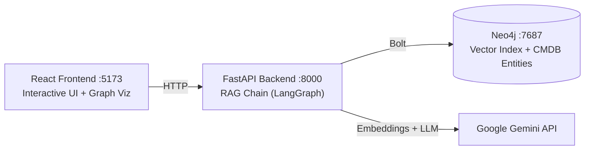

# CMDB Graph RAG Demo

A short demo showcasing **Retrieval-Augmented Generation (RAG)** over a **property graph** for CMDB (Configuration Management Database) relationship queries. This demo runs entirely outside of Rails and uses:

- **LangChain / LangGraph** for RAG orchestration
- **Neo4j** as the property graph database
- **Google Gemini** for embeddings and LLM generation
- **FastAPI** for the backend API
- **React + Vite** for the interactive frontend
- **vis-network** for graph visualization

## Architecture



### Components

1. **docker-compose.yml**: Neo4j + Python app + React frontend
2. **load_graph.py**: Creates sample CMDB graph (Assets, Services, Users, Locations)
3. **embed_nodes.py**: Generates Google Gemini embeddings for all nodes
4. **graph_retriever.py**: Vector similarity search + 1-hop neighbor expansion
5. **rag_chain.py**: LangGraph workflow (Retrieve → Generate) using Gemini
6. **app.py**: FastAPI REST API
7. **frontend/**: React app with chat interface and interactive graph visualization

### Sample CMDB Graph

The demo includes a hardcoded graph with:

- **Assets**: DB-Server, Web-Server-1/2, Load-Balancer, Redis-Cache, Web-API, Backup-Server
- **Services**: Payroll-Service, Email-Service, Employee-Portal
- **Users**: John Smith, Sarah Johnson, Mike Davis
- **Locations**: Data-Center-1, Data-Center-2, HQ-Office

**Relationships**:
- `LOCATED_IN`: Assets → Locations
- `DEPENDS_ON`: Asset dependencies (e.g., Web-Server → Web-API → DB-Server)
- `RUNS_ON`: Services → Assets
- `OWNS`: Users → Services
- `MANAGES`: Users → Assets

## Quick Start

### Prerequisites

- Docker & Docker Compose
- Google Gemini API Key (get one at https://aistudio.google.com/app/apikey)

### Setup

1. **Clone the repository**:
```bash
git clone https://github.com/haadfida/cmdb-graph-rag-demo
cd cmdb-graph-rag-demo
```

2. **Configure environment variables**:
```bash
cp .env.example .env
# Edit .env and add your GOOGLE_API_KEY
```

3. **Start the services**:
```bash
docker compose up --build
```

4. **Load the graph** (in another terminal):
```bash
docker compose exec app python load_graph.py
```

5. **Create embeddings**:
```bash
docker compose exec app python embed_nodes.py
```

6. **Open the app**:
```bash
open http://localhost:5173
```

## Example Questions

Try asking:

- "Where is the DB-Server located?"
- "What assets will break if Web-API goes down?"
- "Who owns Payroll Service?"
- "What services are running in Data-Center-1?"
- "Tell me about the Load-Balancer"
- "Which assets depend on the Redis-Cache?"
- "Show me all services owned by John Smith"


## 🔧 Development

### Project Structure

```
cmdb-graph-rag-demo/
├── docker-compose.yml
├── Dockerfile
├── requirements.txt
├── .env.example
├── backend/
│   ├── app.py              # FastAPI application
│   ├── load_graph.py       # Graph data loader
│   ├── embed_nodes.py      # Embedding generator
│   ├── graph_retriever.py  # Vector search + expansion
│   └── rag_chain.py        # LangGraph RAG chain
└── frontend/
    ├── package.json
    ├── vite.config.js
    ├── index.html
    └── src/
        ├── App.jsx
        ├── components/
        │   ├── ChatPanel.jsx
        │   └── GraphVisualization.jsx
        └── ...
```

### Running Components Separately

**Backend only**:
```bash
docker compose up neo4j app
```

**Frontend only** (requires backend running):
```bash
cd frontend
npm install
npm run dev
```

**Access Neo4j Browser**:
```
http://localhost:7474
Username: neo4j
Password: password123
```

### Testing Individual Components

**Test Graph Retriever**:
```bash
docker compose exec app python graph_retriever.py
```

**Test RAG Chain**:
```bash
docker compose exec app python rag_chain.py
```

## How RAG Works Here

1. **User asks a question** → Frontend sends to `/ask` endpoint
2. **Question Embedding** → Google Gemini creates vector embedding (768-dim)
3. **Vector Search** → Neo4j finds top-k similar nodes (cosine similarity)
4. **Graph Expansion** → Retrieves 1-hop neighbors for context
5. **Context Formatting** → Converts graph data to text
6. **LLM Generation** → Gemini 2.5 Flash answers based on graph context
7. **Response** → Answer + sources + graph data returned to frontend
8. **Visualization** → Interactive graph rendered with vis-network

## Tech Stack

### Backend
- **Python 3.11**
- **FastAPI**: REST API framework
- **LangChain**: LLM orchestration
- **LangGraph**: Workflow management
- **Neo4j**: Graph database
- **Google Gemini API**: Embeddings (embedding-001) + LLM (gemini-2.5-flash)

### Frontend
- **React 18**
- **Vite**: Build tool
- **vis-network**: Graph visualization
- **Axios**: HTTP client

### Infrastructure
- **Docker Compose**: Container orchestration
- **Neo4j 5 Community**: Graph database with APOC + GDS plugins

## Customization

### Add Your Own Data

Edit `backend/load_graph.py` to:
- Add more nodes (Assets, Services, Users, Locations)
- Create new relationships
- Import from CSV or REST API
- Connect to real EZOffice/ServiceNow data

### Change Embedding Model

Edit `backend/embed_nodes.py` and `backend/graph_retriever.py`:
```python
self.embedding_model = "models/embedding-001"  # Gemini's text embedding model
self.embedding_dimension = 768  # Gemini embedding dimension
```

### Change LLM Model

Set `GEMINI_MODEL` in `.env` (default `gemini-2.5-flash`, free tier). Other options: `gemini-2.5-flash-lite` (higher free limits), `gemini-2.5-pro` (more capable, tighter free limits).

## Next Steps

If you like this demo, you can:

1. **Import Real Data**:
   - Connect to ServiceNow/EZOffice APIs
   - Import from CSV exports
   - Set up real-time ETL pipelines

2. **Deploy to Production**:
   - Use managed Neo4j (Neo4j Aura)
   - Deploy FastAPI to cloud (AWS/GCP/Azure)
   - Host frontend on Vercel/Netlify
   - Add authentication & authorization

3. **Enhance Features**:
   - Add more relationship types
   - Implement change tracking
   - Create impact analysis dashboards
   - Add alerts and monitoring

4. **Integration**:
   - Mount Neo4j into your dev stack
   - Iframe the React panel into EZOffice UI
   - Expose API for other services
   - Build Slack/Teams bot integration

## API Documentation

### POST `/ask`

Ask a question about the CMDB.

**Request**:
```json
{
  "question": "Where is the DB-Server located?"
}
```

**Response**:
```json
{
  "question": "Where is the DB-Server located?",
  "answer": "The DB-Server is located in Data-Center-1, which is in Virginia, US-East region.",
  "sources": [
    {
      "name": "DB-Server",
      "type": "Asset",
      "properties": {...}
    },
    {
      "name": "Data-Center-1",
      "type": "Location",
      "properties": {...}
    }
  ],
  "graph_data": {
    "nodes": [...],
    "relationships": [...]
  }
}
```

### GET `/examples`

Get example questions to try.

**Response**:
```json
{
  "examples": [
    "Where is the DB-Server located?",
    "What assets will break if Web-API goes down?",
    ...
  ]
}
```

### GET `/health`

Health check endpoint.

## Troubleshooting

**Neo4j connection issues**:
- Wait for Neo4j to fully start (check `docker compose logs neo4j`)
- Verify credentials in `.env`

**Embedding creation fails**:
- Check OPENAI_API_KEY is set correctly
- Ensure you have API credits

**Frontend can't connect to backend**:
- Verify backend is running on port 8000
- Check CORS settings in `backend/app.py`

**Graph doesn't display**:
- Check browser console for errors
- Verify graph data in API response
- Try a different question

## License

MIT License - Feel free to use this demo for learning and development!

## Contributing

This is a demo project, but contributions are welcome! Feel free to:
- Report bugs
- Suggest features
- Submit pull requests
- Share your use cases

## Support

For questions or issues, please open a GitHub issue.

---
